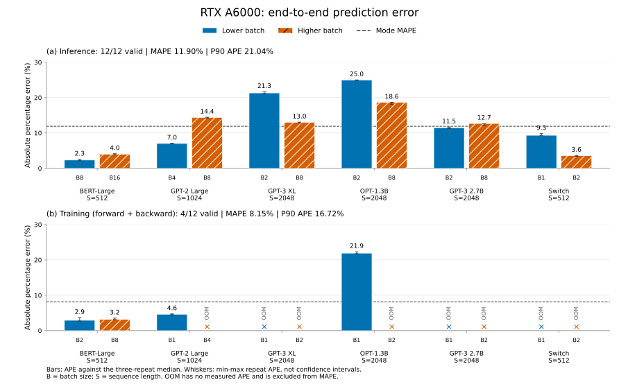
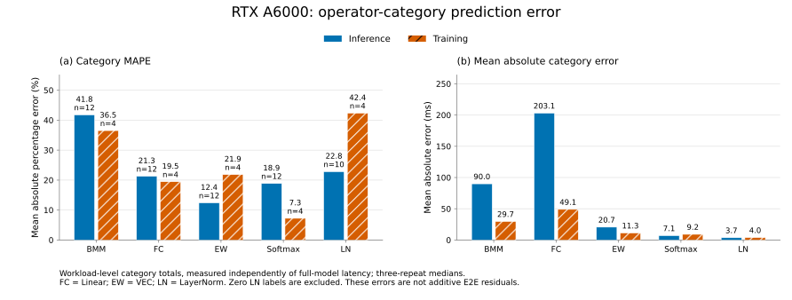
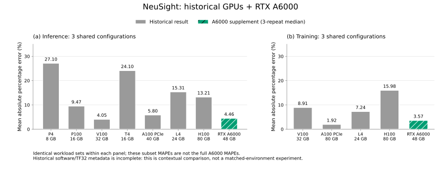

# NeuSight

NeuSight is a framework designed to predict the performance of deep learning training and inference on various GPUs. For more details, please refer to our paper, [Forecasting GPU Performance for Deep Learning Training and Inference](https://dl.acm.org/doi/10.1145/3669940.3707265).

## Installation

To install NeuSight as a Python package, run:

```bash
git clone https://github.com/sitar-lab/NeuSight.git
cd NeuSight
pip install -e .
```
- NeuSight was tested on Python 3.9 and PyTorch version 2.1.0.

## Quick Start

We provide two Python scripts for predicting the latency of deep learning execution and training the predictor:

 - `scripts/pred.py` for making predictions
 - `scripts/train.py` for training the predictor

The scripts use GPU and deep learning description files in JSON format, and execution hyperparameters such as batch size. See the scripts in `scripts/example` for examples of how to use these scripts.

## RTX A6000 实验（中文）

RTX A6000 补充实验使用冻结的预测器权重与原始 tile 表，仅评测，不回填训练数据。每项配置使用单卡、FP32、eager，关闭 matmul 与 cuDNN TF32；两张空闲 GPU 仅用于并行执行独立任务。这是**未见 GPU 型号的泛化实验**，不是未见架构实验，原训练数据中已有同属 Ampere 的 A100。本轮只评估 NeuSight，不包含其他预测器在 A6000 上的基线结果。

### 结果概览

24 项预测全部成功；72 个正式轮次最终为 48 次成功、24 次 OOM，对应 **16 个三轮有效配置、8 个训练 OOM 配置**。主指标以三轮实测的中位数计算，失败项不计零误差。

| 模式 | 有效配置 / 计划配置 | MAPE | APE 中位数 | P90 APE |
|---|---:|---:|---:|---:|
| 推理 | 12 / 12 | **11.90%** | 12.08% | 21.04% |
| 训练（前向 + 反向） | 4 / 12 | **8.15%** | 3.90% | 16.72% |

正式端到端测量的最大三轮极差 / 中位数为 **0.92%**。训练精度仅代表成功的 4 个配置，不能推广到全部训练矩阵；训练计时不含 loss 的前向计算与 optimizer step，推理为给定序列的一次 forward，不含自回归 decode。

### Figure A1：端到端预测误差



沿用论文 [Figure 7](https://arxiv.org/html/2407.13853v3#S6.F7) 的推理 / 训练分面思路，展示六个模型、两个 batch 的全部配置。柱高为相对三轮实测中位数的 APE；误差线是三轮 APE 的最小至最大范围，**不是置信区间**。虚线为该模式的 MAPE，`B` 为 batch size，`S` 为序列长度。OOM 保留位置但不画零误差柱。推理最大 APE 为 OPT-1.3B、batch 2 的 **24.97%**；成功训练配置中，OPT-1.3B、batch 1 为 **21.90%**。

矢量版：[SVG](docs/figures/a6000_e2e_error.svg) · [PDF](scripts/asplos/summary_a6000/figures/a6000_e2e_error.pdf)

### Figure A2：算子类别误差



沿用论文 [Figure 8](https://arxiv.org/html/2407.13853v3#S6.F8) 的 BMM、FC、EW、Softmax、LN 分类，分别展示推理和训练的类别 MAPE，以及平均绝对误差（ms）。`n` 是实测为正的有效 workload 数，推理 LN 的两项零标签被排除。推理 BMM 的 MAPE 最高（**41.81%**），训练 LN 最高（**42.37%**）；按绝对毫秒误差看，两种模式均以 FC / Linear 最大。类别统计先在每个 workload 内汇总算子耗时再求误差，**不是逐算子实例 APE 的平均值，也不是端到端残差的可加分解**。

矢量版：[SVG](docs/figures/a6000_operator_error.svg) · [PDF](scripts/asplos/summary_a6000/figures/a6000_operator_error.pdf)

### Figure A3：历史 GPU 结果加入 A6000



灰色柱不是新的 A6000 测量，也不是从论文图片读出的数值。论文 [Figure 7](https://arxiv.org/html/2407.13853v3#S6.F7)（第 6.2 节）展示了 NeuSight 在 8 张 GPU、6 个模型和不同 batch size 上的单设备推理 / 训练端到端预测百分比误差；论文 artifact appendix 明确说明该图的数据位于 `scripts/asplos/summary/`。本图中的灰色 GPU 为论文这组单设备评测中的 P4、P100、V100、T4、A100 PCIe 40GB、A100 PCIe 80GB、L4 和 H100，仅取其中 **NeuSight、非融合、单卡执行**的结果。

具体来源链路是：仓库原始历史标签和预测结果分别位于 [`scripts/asplos/label/`](scripts/asplos/label/) 和 [`scripts/asplos/results/`](scripts/asplos/results/)；[`scripts/asplos/summary/summary.csv`](scripts/asplos/summary/summary.csv) 是由 [`scripts/asplos/summarize.py`](scripts/asplos/summarize.py) 汇总出的历史结果表。A3 的汇总脚本依据该表筛选旧 NVIDIA 单卡记录，再读取对应的历史 label / prediction JSON 重新计算 APE，并写入本地 `scripts/asplos/summary_a6000/common_config_comparison.csv`。因此灰色柱表示**历史仓库数据在下面三项共同有效配置上的 MAPE**，不是论文 Figure 7 的全量 GPU MAPE，也不是从图像反推的近似值；绿色柱为本次 A6000 补充实验。**每个面板的所有 GPU 使用完全相同的三个有效配置**，避免将不同 GPU 的不同成功配置集合直接比较：

- 推理共同配置：BERT-Large（S=512，B=8 / 16）、GPT-2 Large（S=1024，B=4）。
- 训练共同配置：BERT-Large（S=512，B=2 / 8）、GPT-2 Large（S=1024，B=1）。

共同子集上的 A6000 MAPE 为推理 **4.46%**、训练 **3.57%**，**不能替代上表的全量 11.90% / 8.15%**。历史结果缺少完整的软件环境和 TF32 记录，本图仅作背景对照，不应解读为严格同环境的 GPU 间精度排名。

矢量版：[SVG](docs/figures/a6000_gpu_comparison.svg) · [PDF](scripts/asplos/summary_a6000/figures/a6000_gpu_comparison.pdf)

### 图表复现与实验资料

从仓库根目录运行以下命令；绘图仅使用 CPU，读取已经生成并验收的本地汇总，不重新测量或训练：

```bash
.venv_a6000/bin/python -m pip install -r ext_scripts/requirements-a6000-plots.txt
.venv_a6000/bin/python ext_scripts/scripts/plot_a6000.py
.venv_a6000/bin/python -m unittest discover -s ext_scripts/tests -v
```

图表脚本先检查验收状态和源表 SHA-256，再独立重算并核对图中指标；输出 300 DPI PNG、可编辑 SVG、矢量 PDF、精简绘图数据快照及 `manifest.json`。可用 `--summary-dir`、`--output-dir` 指定目录。README 使用的三张 SVG 展示副本位于 `docs/figures/`；完整 PNG/SVG/PDF 和数据快照仍写入本地汇总目录。

**实验报告、原始数据和完整图表产物仍是本地产物，位于被 Git 忽略的 `scripts/asplos/summary_a6000/`，不随仓库克隆分发；README 中的三张 SVG 展示副本除外。** 新克隆需先按运行说明生成、验收实验汇总，再执行绘图命令，才能重建完整图表和本地图片。

- [实验说明与实测口径](scripts/asplos/README.md)：完整模型计时、采样与三轮汇总、算子测量的区别。
- [分阶段运行说明](ext_scripts/docs/A6000_RUNNER.md)：独立环境配置、预测、试跑、正式测量、汇总与验收命令。
- 本地结果报告：[中文版](scripts/asplos/summary_a6000/REPORT_ZH.md) / [英文版](scripts/asplos/summary_a6000/REPORT.md)。中文版为另行整理的本地文档，不由汇总脚本自动生成或更新。

## Tool Inputs
NeuSight requires two input files to run: a device configuration file and a deep learning model configuration file.

### Device Configuration File

The device configuration file specifies the architectural parameters of the prediction target GPU. Example configuration files can be found in `data/device_configs`. The configuration file includes
  - `Device`      : User-specified name of the device
  - `Dev_Mem`     : Global memory in GB
  - `Mem_Bw`      : Memory bandwidth of global memory in GB/s
  - `Num_Sm`      : Number of SMs
  - `Core_Per_SM` : Number of CUDA cores per SM
  - `Freq`        : Compute frequency in GHz
  - `SingleFLOPs` : Peak FP32 performance in GFLOPS/s
  - `L2Cache`     : Size of L2 Cache in MB

### Deep Learning Model Configuration File

The deep learning model configuration file specifies the architectural parameters of the target deep learning model. Example configuration files can be found in  `data/DLmodel_configs`. Configuration file are specified in `Hugging Face` model description format.

## Code Structure
```bash
/ : NEUSIGHT_ROOT
|-- neusight                     : Source file directory for NeuSight
|   |-- Dataset                  : For collecting and processing dataset for training
|   |-- Model                    : For machine learning based predictor
|   |-- Opgraph                  : For manipulating operator graphs
|   |-- Prediction               : For NeuSight predictor
|   |-- Tracing                  : For tracing ML model graphs
|-- scripts                      : Main scripts for running NeuSight
|   |-- asplos                   : Training dataset and scripts used for ASPLOS 2025 paper
|   |   |-- data                 : Input files used for NeuSight
|   |   |   |-- dataset          : Datasets used for training and tile table (NVIDIA)
|   |   |   |-- dataset_amd      : Datasets used for training and tile table (AMD)
|   |   |   |-- device_configs   : GPU description files
|   |   |   |-- DLmodel_configs  : DL model description files
|   |   |   |-- predictor        : Model configuration and trained parameters for ML predictor
|   |   |-- label                : Measured latencies for ML models evaluated
|   |   |-- results              : Results of NeuSight prediction
|   |   |-- summary              : Summary of NeuSight prediction
|   |-- example                  : Example scripts for running NeuSight
```

## Citation
If you use NeuSight in your research, please cite our paper:

```
@inproceedings{neusight,
  author = {Lee, Seonho and Phanishayee, Amar and Mahajan, Divya},
  title = {Forecasting GPU Performance for Deep Learning Training and Inference},
  year = {2025},
  isbn = {9798400706981},
  publisher = {Association for Computing Machinery},
  address = {New York, NY, USA},
  url = {https://doi.org/10.1145/3669940.3707265},
  doi = {10.1145/3669940.3707265},
  booktitle = {Proceedings of the 30th ACM International Conference on Architectural Support for Programming Languages and Operating Systems, Volume 1},
  pages = {493–508},
  numpages = {16},
  keywords = {deep learning, gpu performance forecasting, ml for systems, training and inference},
  location = {Rotterdam, Netherlands},
  series = {ASPLOS '25}
}
